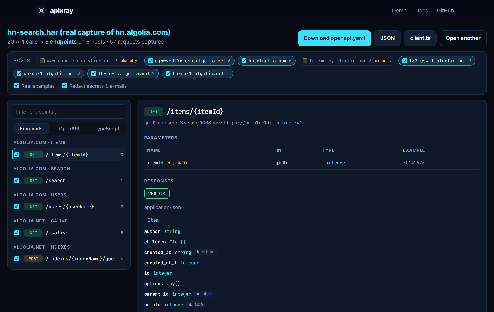
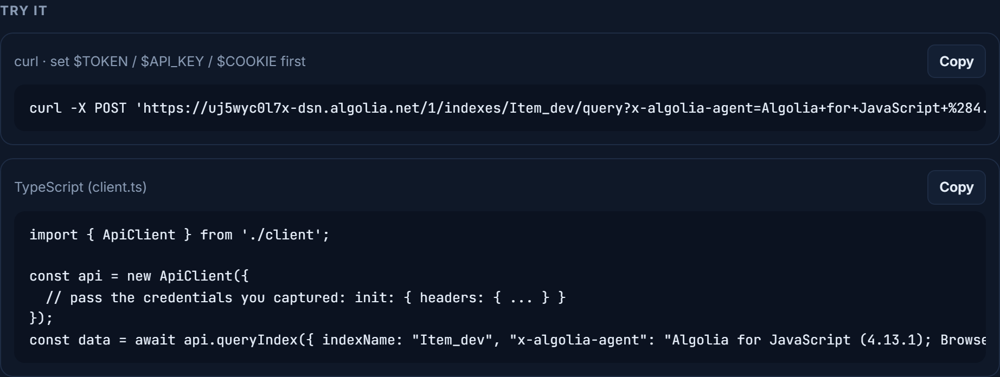

<div align="center">

# apixray

**X-ray any web app's API.** Use the app, get the spec.

apixray turns real browser traffic into an **OpenAPI 3.1** document, a typed **TypeScript client**
and ready-to-run **curl** commands. It infers path parameters, schemas, enums, nullable fields and
auth along the way, and redacts secrets by default.

[**Try it in your browser**](https://feresbr1.github.io/apixray/) ·
[Live demo on a real capture](https://feresbr1.github.io/apixray/#/explore?demo) ·
[Releases](https://github.com/feresbr1/apixray/releases) ·
[Issues](https://github.com/feresbr1/apixray/issues)



</div>

## Two ways in

**1. Record:** one command, using a browser you already have.

```console
$ npx github:feresbr1/apixray record "https://hn.algolia.com/?q=sqlite" --headless --duration 8
apixray: recording https://hn.algolia.com/?q=sqlite
  Use the app: log in, click around, trigger the features you care about.
  Stopping after 8s.

  POST   200 www.google-analytics.com/j/collect
  GET    200 telemetry.algolia.com/1/settings
  POST   200 uj5wyc0l7x-dsn.algolia.net/1/indexes/Item_dev/query
  POST   204 www.google-analytics.com/g/collect
  POST   204 www.google-analytics.com/g/collect
  GET    200 c3-de-1.algolia.net/1/isalive
  GET    200 t5-in-1.algolia.net/1/isalive
  GET    200 t5-eu-1.algolia.net/1/isalive

apixray: captured 8 API calls.

apixray · 4 API calls → 2 endpoints on 4 hosts (8 requests captured)
  https://c3-de-1.algolia.net/1  (+2 more hosts of algolia.net)
    GET    /isalive                                 3×  200  getIsalive
  https://uj5wyc0l7x-dsn.algolia.net/1
    POST   /indexes/Item_dev/query                  1×  200  queryItemDev
  auth: query x-algolia-api-key (values never written)
  skipped telemetry: www.google-analytics.com, telemetry.algolia.com (--include-noise keeps them)

Wrote apixray-out/openapi.yaml, apixray-out/client.ts, apixray-out/capture.har
```

That is real output from an 8-second headless recording. Without `--headless`, a browser window
opens and recording stops when you close it. Analytics were
skipped, three Algolia hosts were merged into one endpoint, and the API key became a security
scheme without its value. Use the app longer and more endpoints appear: the
[demo capture](https://feresbr1.github.io/apixray/#/explore?demo) of the same site has 5 endpoints,
including `POST /indexes/{indexName}/query` once two index names were seen.

**2. Drop a HAR file:** no install at all. In any browser's DevTools, open the **Network** tab, use
the app, and export (Chrome/Edge: the _Export HAR_ download icon; Firefox: right-click → _Save All As
HAR_; Safari: _Export_). Drop the file on [feresbr1.github.io/apixray](https://feresbr1.github.io/apixray/).
It is parsed in your browser and never uploaded.

## What it figures out

- **Path templates.** `/users/42` and `/users/97` become `/users/{userId}`. Numbers, UUIDs, hashes,
  ULIDs, dates and ids like `ord_10023` are recognised. Word-like values are merged only when their
  responses have the same structure: `/pokemon/pikachu` and `/pokemon/eevee` become
  `/pokemon/{pokemonName}`, while `/products` and `/customers` stay separate. A shared `/api/v1`
  prefix moves into the server URL.
- **Schemas from every sample.** A field missing from some responses is optional; a field that was
  ever `null` is nullable. Small repeated sets of strings become enums, and dates, e-mails, URLs,
  UUIDs and IPs get formats. Objects keyed by ids become maps (`additionalProperties`), and trees
  such as comment threads become a recursive `$ref` instead of nesting forever.
- **Auth.** Bearer tokens (JWT detected), Basic auth, API-key headers and query parameters, and
  session cookies become OpenAPI security schemes. Their values never reach the output.
- **Parameters.** Query parameters (required when always present, arrays when repeated) and custom
  `x-*` request headers are captured, along with JSON, form and multipart request bodies and one
  response per status code.
- **Noise.** Scripts, styles, images, preflights and analytics or telemetry hosts are skipped (you
  can switch them back on). Hosts of one site are merged into one API with several servers.
- **Names a human would pick.** `listUsers`, `getUser`, `createUser`, `deleteUser`,
  `listUserOrders`, `cancelOrder`, `queryIndex`, `search`.

## What you get

| File           |                                                                                                                                                                             |
| -------------- | --------------------------------------------------------------------------------------------------------------------------------------------------------------------------- |
| `openapi.yaml` | OpenAPI 3.1, with real (redacted) examples. Import it into Postman, Bruno, Insomnia, Hoppscotch or Swagger UI, generate SDKs with openapi-generator, or mock it with Prism. |
| `client.ts`    | A dependency-free, fetch-based TypeScript client: one typed method per operation, `ApiError` on non-2xx, credentials via options.                                           |
| `capture.har`  | The raw recording (from `record`), to re-run or share privately.                                                                                                            |

Generated with apixray from a recording of a small demo app:

```ts
import { ApiClient } from './client';

const api = new ApiClient({ init: { headers: { Authorization: `Bearer ${token}` } } });
const page = await api.listUsers({ page: 1, limit: 10 }); // typed: { items: { id: number; name: string }[]; page: number; total: number }
const user = await api.getUser({ userId: 2 });
await api.deleteUser({ userId: 2 });
```

<p align="center">
  
</p>

## CLI

Requires **Node.js 22+**, and for `record` a Chrome, Edge, Brave or Chromium installation.

```text
apixray record <url> [options]      Open a browser, use the app, close it: get an OpenAPI spec
apixray <capture.har>... [options]  Convert HAR files exported from browser DevTools or a proxy
```

| Option                         |                                                                     |
| ------------------------------ | ------------------------------------------------------------------- |
| `-o, --out <dir>`              | Output folder (default `apixray-out`)                               |
| `--stdout`                     | Print the OpenAPI document instead of writing files                 |
| `--format yaml\|json`          | OpenAPI format (default `yaml`)                                     |
| `--origin <url>`               | Only include this origin (repeatable)                               |
| `--include-noise`              | Keep analytics and telemetry hosts                                  |
| `--no-examples`                | Leave real examples out of the spec                                 |
| `--no-redact`                  | Keep tokens, keys and e-mail addresses in examples                  |
| `--title <name>`               | API title in the spec                                               |
| `--browser <path>`             | Browser executable (default: auto-detect; or set `APIXRAY_BROWSER`) |
| `--profile <dir>`              | Reuse a browser profile to stay logged in between recordings        |
| `--headless`, `--duration <s>` | Record without a window, for a fixed time (scripts, CI)             |
| `--no-har`                     | Don't save `capture.har`                                            |

```sh
# Several captures merge into one spec
npx github:feresbr1/apixray monday.har tuesday.har -o api/

# Just the API you care about, to stdout
npx github:feresbr1/apixray capture.har --origin https://api.example.com --stdout > openapi.yaml

# Record while logged in, keeping the session for next time
npx github:feresbr1/apixray record https://app.example.com --profile .apixray-profile
```

Install it to drop the `npx github:` prefix: `npm install -g github:feresbr1/apixray`. Or download
`apixray.mjs` from the [latest release](https://github.com/feresbr1/apixray/releases/latest) and run
`node apixray.mjs`.

## How recording works

`apixray record` starts your browser with a fresh temporary profile and a DevTools port, attaches to
every tab over the **Chrome DevTools Protocol** (using Node's built-in WebSocket), then opens the
URL. It downloads response bodies only for API-looking requests (XHR, fetch, JSON). When you close
the window, the profile is deleted and the traffic goes through the same analysis as a HAR file. No
proxy and no certificate are involved.

## Privacy and responsible use

- The web app reads files locally; nothing is uploaded. The CLI writes only to the folder you choose.
- Credentials never reach the generated spec, client or curl commands; examples are scrubbed of
  tokens, JWTs and e-mail addresses unless you pass `--no-redact`. **`capture.har` is not
  redacted**: it is the raw traffic, including cookies. Don't share it.
- Recent Chrome versions can export "sanitized" HAR files without cookies and auth headers. Those
  are safer to handle, but auth schemes then can't be detected.
- Reverse-engineer only APIs you're allowed to use: your own apps, your company's, or services whose
  terms permit it.

## Limitations

- The spec describes what was observed. Endpoints you didn't trigger are missing, and a field that
  happened to be present every time is marked required. Capture more to refine it.
- A path value seen only once can't be told apart from a fixed path segment (`/indexes/Item_dev`
  stays literal until a second index name appears).
- GraphQL shows up as one `POST /graphql` operation; WebSocket messages and response headers are
  not modelled yet.
- Two unrelated sites with the same path and method can't share one OpenAPI document; apixray keeps
  the first and notes it in the description. Use `--origin` to export them separately.

## Development

```sh
npm install
npm run check        # format, lint, typecheck, unit + CLI tests (incl. headless recording), build
npm run test:e2e     # Playwright tests of the web app, desktop and mobile
npm run dev          # the web app
```

Tests validate generated specs against the official OpenAPI 3.1 schema, check that YAML output
parses back to the identical document, compile the generated client with `tsc --strict` and call a
live server with it, and record a real headless Chromium session.

Tech: TypeScript, Preact + Vite (web app), esbuild (single-file CLI, no runtime dependencies),
Vitest, Playwright. See [CONTRIBUTING.md](CONTRIBUTING.md) and the reasoning behind the project in
[docs/PRODUCT_DECISIONS.md](docs/PRODUCT_DECISIONS.md).

## License

[MIT](LICENSE)
